# AI Showdown

A parody 2-player 3D fighting game in which caricatures of AI-industry public personas settle the future of AI in the ring. A fun parody project built in **Godot 4.7**, forked from [clintcan/3d-fighter](https://github.com/clintcan/3d-fighter).

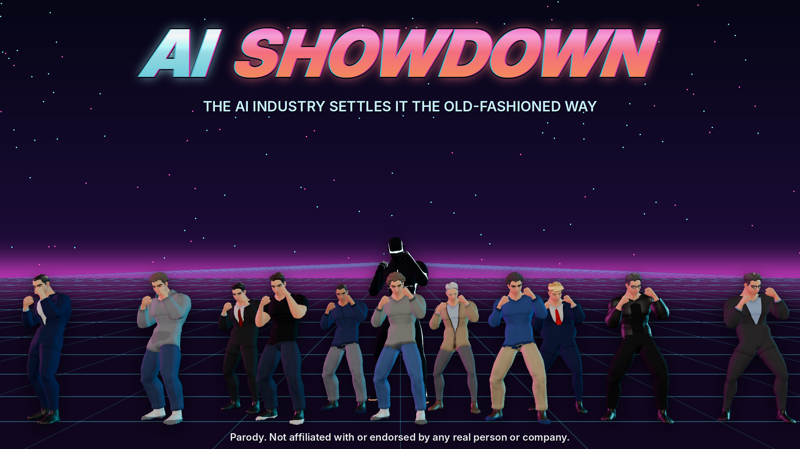

> **Parody. Not affiliated with or endorsed by any real person or company.**
> The satire targets public personas and ideas only.

## Features

- **11 fighters**: 10 AI-industry caricatures plus AGI, the final boss. Each is built on one of the original fighters' movesets (see the roster below), with its own special names, super and outfit.
- **4 stages**: Server Farm, Mensa (a university cafeteria), Senate Hearing Room and GPU Foundry.
- **Modes**:
  - **Story**: a fighter-specific campaign with an intro, pre- and post-fight dialogue, a rival bout, AGI in the Senate and an ending (`scripts/story/`, `data/story/`);
  - **Vs CPU** and **Versus** (2 local players);
  - **1v1 Quick Match**: you against a random CPU on a random stage, one round;
  - **Training**;
  - **Arcade**, a ladder that ends with AGI as final boss in the Senate (pick AGI and you get its shadow instead);
  - **Demo** (two CPU fighters).
- Best of 3 rounds (except **1v1 Quick Match**, which is a single round).
- The Online menu is hidden (`SHOW_ONLINE = false` in `scripts/ui/main_menu.gd`) because `online/servers.json` still points at the original game's lobby server.
- Fighting-game systems inherited from the original engine: one-button Power specials, a super meter with cinematic supers, counter hits, throws, blocking and sidesteps, plus a deterministic 60 Hz simulation with a headless regression suite. No motion inputs are needed to play.

## Screenshots

| | |
|---|---|
| 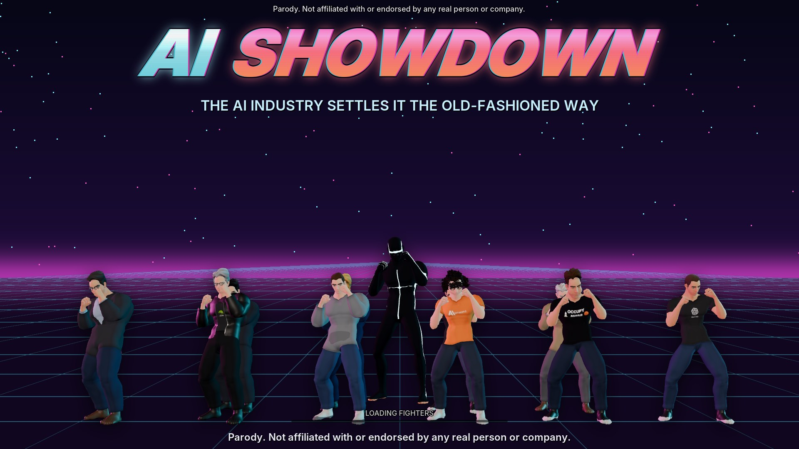 | 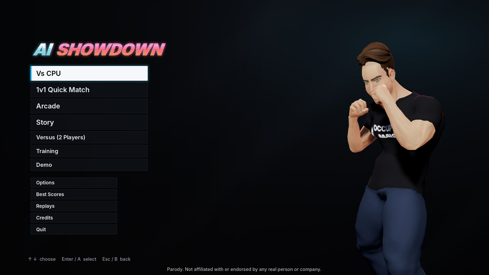 |
| 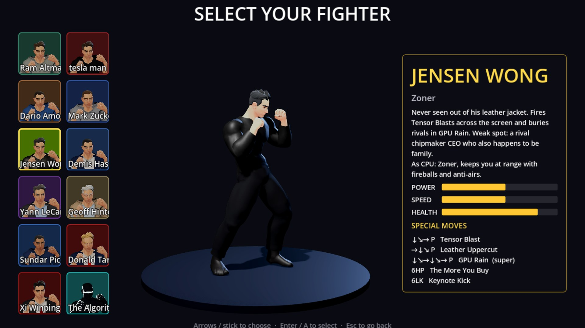 | 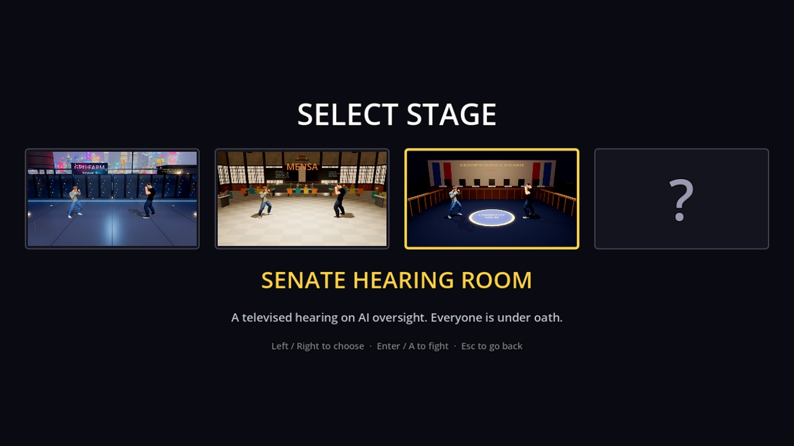 |
| 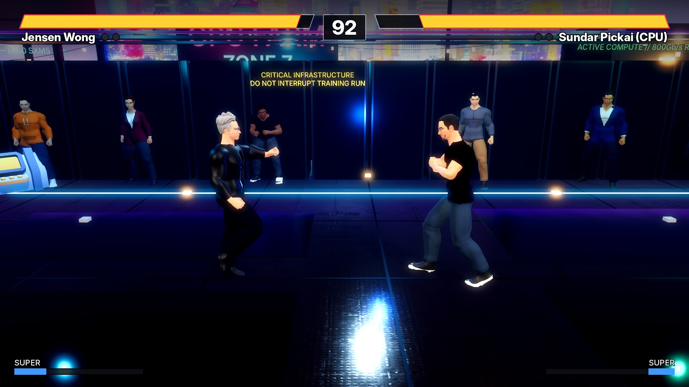 | 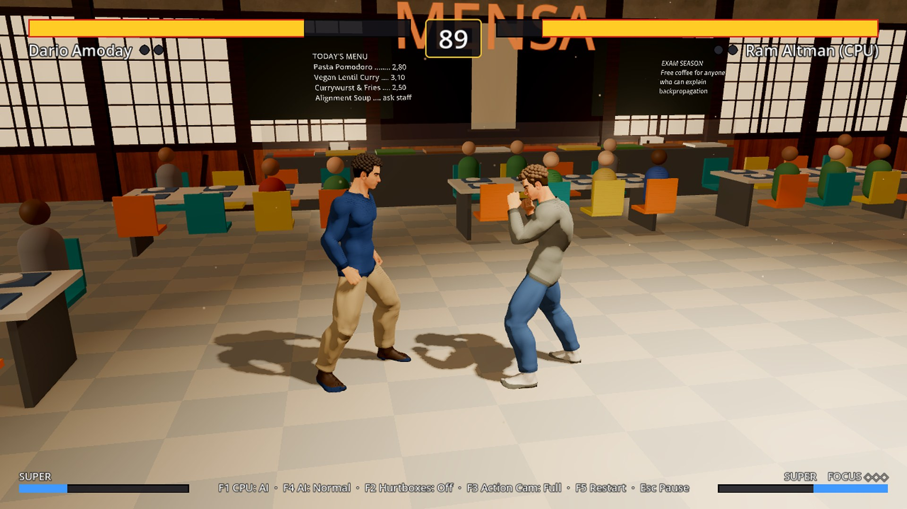 |
| 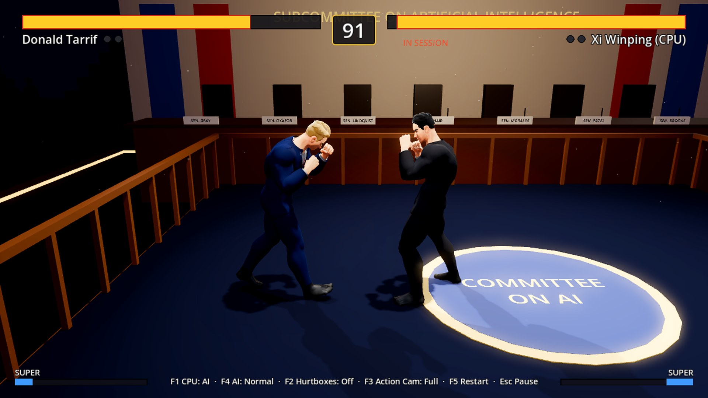 | 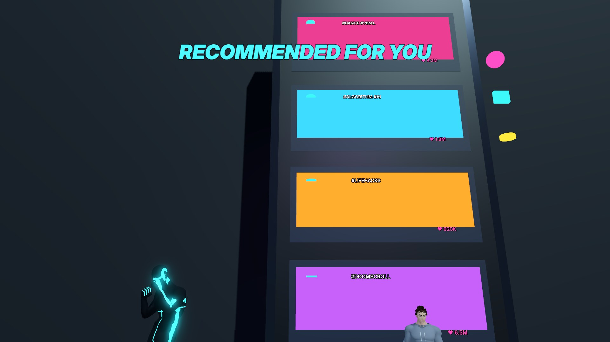 |
| 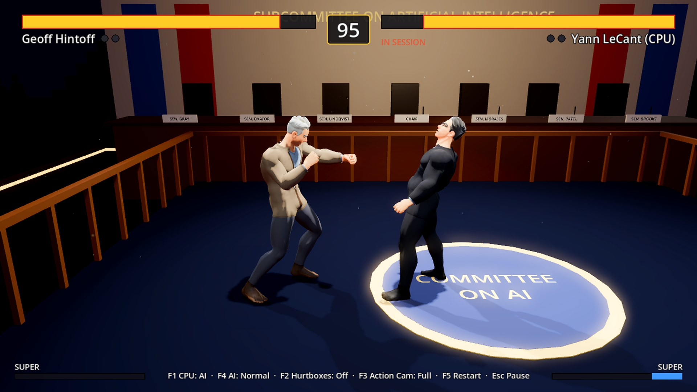 | |

## Roster

Fighters have individual builds (height, belly, slim or heavy), glasses and hair pieces, defined per fighter in the roster builder.

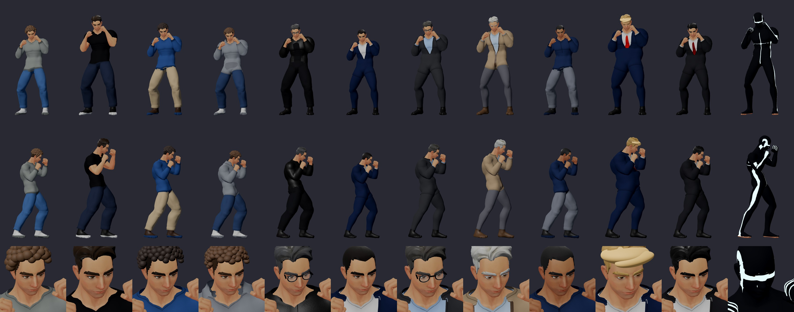

| id | Name | Kit (original moveset) | Super |
|---|---|---|---|
| ram | Ram Altman | mira | Scaling Law (powers up with the "Add More Compute" stance) |
| tesla | tesla man | rhea | Rocket Launch |
| dario | Dario Amoday | lian | Constitutional Shield (counter stance: Refusal Stance) |
| zuckerbot | Mark Zuckerbot | valka | Metaverse Trap (grab) |
| jensen | Jensen Wong | kenji | Leather Jacket Tornado |
| yann | Yann LeCant | brutus | It's Just Autocomplete |
| geoff | Geoff Hintoff | aelia (super armour) | I Regret Nothing... Wait |
| sundar | Sundar Pickai | kenji (tankier, slower) | 404 Not Found |
| donald | Donald Tarrif | valka (heavier) | Shower of Tariffs |
| xi | Xi Winping | aelia | Open-Source Squad |
| algorithm | AGI (final boss) | rhea | Engagement Loop |

## Stages

- **Server Farm**: the original rooftop, rethemed.
- **Mensa**: a university cafeteria, rethemed from the dojo.
- **Senate Hearing Room**: the boxing ring, with the ropes replaced by a railing.
- **GPU Foundry**: the night market, turned into a semiconductor cleanroom with an EUV scanner, wafer pods and bunny-suit technicians.

The retheme code is `scripts/stages/stage_retheme.gd`; the scenes `scenes/stages/server_farm.tscn`, `mensa.tscn`, `senate.tscn` and `foundry.tscn` inherit the originals.

## Controls

| | Keyboard (P1) | Gamepad |
|---|---|---|
| Move / jump / crouch | W A S D | Left stick / D-pad |
| Light / Heavy Punch | U / I | X / Y |
| Light / Heavy Kick | J / K | A / B |
| Power special | O | LB |
| Super | P | RT |
| Sidestep | L | RB |
| Pause & move list | Esc | Start |

- **Power specials:** the Power button fires the fighter's signature special; hold a direction (forward, back or down) with Power for the other specials. **Super** fires the super once the meter is full. No motion inputs to learn; the pause menu lists each fighter's moves.
- **Player 2** uses the arrow keys with numpad 4/5 (punches), 1/2 (kicks), 7/8 (Power/Super) and 6 (sidestep), or a second gamepad. On keyboards without a numpad the fallback keys are `[` `]` (punches), `;` `'` (kicks), `\` (Power), `=` (Super) and `/` (sidestep).
- **Remapping:** every key and gamepad button can be changed per player in **Options → Controls**.

## Power-move voice drop-in

Put one audio file per fighter at `assets/audio/voice/fighters/<id>_super_1.ogg` (`.wav` and `.mp3` also work). Extra takes `_2` to `_8` are picked at random.

The 11 ids: `ram`, `tesla`, `dario`, `zuckerbot`, `jensen`, `yann`, `geoff`, `sundar`, `donald`, `xi`, `algorithm`. For example `ram_super_1.ogg`, `tesla_super_1.ogg`, ... `algorithm_super_1.ogg`.

- Open the project in the Godot editor (or run `godot --headless --path . --import`) so the file is imported.
- Optional: `python tools/build_voice_envelopes.py` (needs ffmpeg) makes the mouth move with the voice.
- Without a file, supers are silent; special and KO shouts fall back to an original male fighter's voice (`CharacterData.voice_fallback`).

## Run from source

Requires **Godot 4.7** with a Vulkan-capable GPU.

```bash
godot -e --path .   # open in the editor
godot --path .      # run the game
```

## How the roster is built

- The original 8 fighters live in `data/kits/` (movesets, CPU personalities, showcase routines). The engine regression tests run against them via `GameState.use_engine_content()`.
- `data/characters/<id>.tres` is generated by `godot --headless --path . -s res://tools/build_showdown_roster.gd`. It copies kit moves into `data/moves/<id>/`, renames specials and scales damage (`CharacterData.kit` names the source kit).
- **Outfits:** `tools/build_outfits.gd` (`_showdown_specs`): suits with ties, sweaters, tee and jeans, leather jacket, hoodie, cardigan, glowing bodysuit.
- **Portraits and cut-ins:** `tools/render_portraits.gd`, `tools/render_cutins.gd`.
- **Key art:** `tools/render_key_art.gd`, then `python tools/build_showdown_art.py` (logo, splash, wallpaper, icon; Inter Display font, OFL).
- **Stage thumbnails:** `tools/render_stage_thumbs.gd`. **Screenshots:** `tools/render_screenshots.gd`.

Rendering tools need a renderer:

```bash
xvfb-run -a -s "-screen 0 1920x1080x24" godot --rendering-driver opengl3 --path . -s res://tools/<tool>.gd
```

Design notes for the original kits are in [docs/characters](docs/characters/README.md). Assets are committed as normal files (no Git LFS).

## Tests

```bash
godot --headless --path . -s res://tests/sim_test.gd   # exit code 1 on failure
```

The suite runs the original engine tests on the kits plus AI Showdown checks: all 11 fighters load with moves and a super, a CPU-vs-CPU match finishes for each, the stages, and the disclaimer.

## Build releases

This needs the Godot 4.7.2 export templates for Windows, macOS and Linux, plus Python 3.

```bash
python tools/build_release.py all                     # Windows + macOS + Linux -> dist/
python tools/build_release.py windows linux           # any subset
python tools/build_release.py all --test              # run the tests first, stop on failure
python tools/build_release.py all --version 0.3.0 --test --notarize   # full release
```

| Output | Contents |
|---|---|
| `dist/AIShowdown-v<ver>-windows.zip` | Single exe plus README; smoke-tested |
| `dist/AIShowdown-v<ver>-macos.zip` | Universal `.app`, signed with Developer ID; `--notarize` notarizes and staples it |
| `dist/AIShowdown-v<ver>-linux.tar.gz` | x86_64 binary plus README; smoke-tested in WSL when available |

Mac signing reads its credentials from `%USERPROFILE%\AppleDeveloper`, which stays outside the repo. Use `--no-sign` for a local unsigned build.

## Project layout

```
scripts/   gameplay (fighter, AI, camera, FX, UI, arcade, training)
scenes/    menus, fight scene, stages
data/      kits (original movesets), characters and moves (generated)
tools/     generators (roster, outfits, art, screenshots) and build_release.py
tests/     headless simulation tests
```

## Credits and license

Based on [3D Fighter](https://github.com/clintcan/3d-fighter) by Clint Christopher Canada (MIT / CC BY 4.0). The in-game Credits screen credits the original too.

- **Code:** [MIT License](LICENSE).
- **Original assets:** [CC BY 4.0](LICENSE-ASSETS.md).
- **Third-party assets:** keep their own licenses; the full list is in [assets/CREDITS.md](assets/CREDITS.md).

Made with [Godot Engine](https://godotengine.org).

## Contributing

See [docs/CONTRIBUTING.md](docs/CONTRIBUTING.md) for how to add or change fighters, moves, voices, stages and title art.
