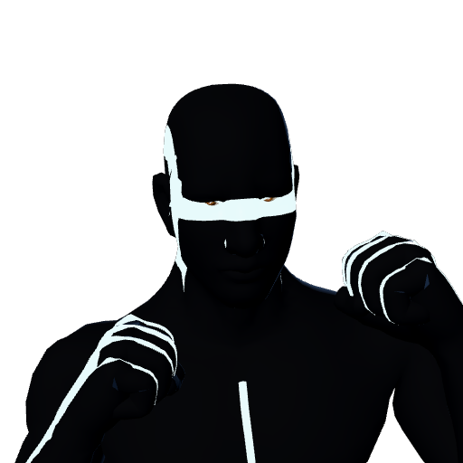
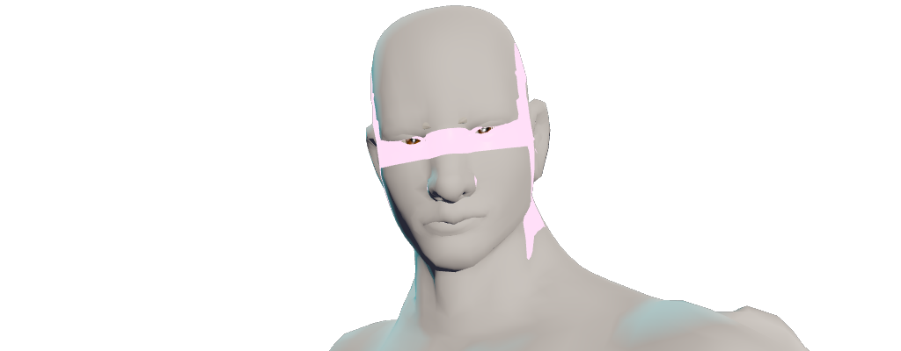
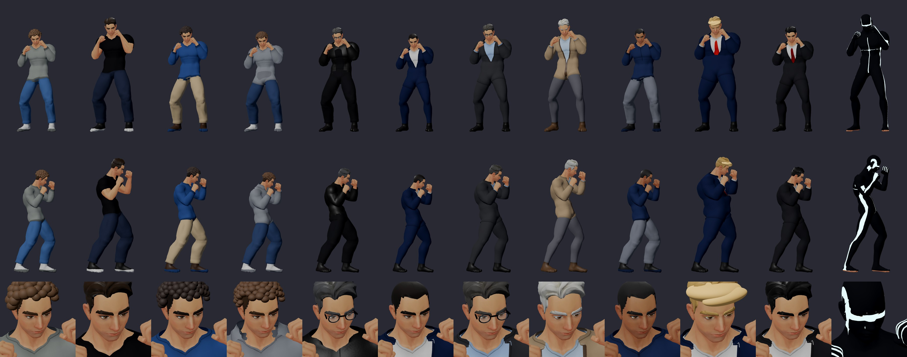

# Character Review: AGI (Likeness Pass)

## 1. Overview & Status

- **Character Name**: AGI
- **ID**: `algorithm`
- **Archetype**: Boss
- **Base Kit**: Rhea (`data/kits/rhea.tres`)
- **Voice**: Jin (`voice_fallback = &"jin"`)
- **Review Status**: **Approved**

---

## 2. Visual Pass

### Chassis, Visor & Synthetic Head

- Ageless synthetic intelligence entity: sleek humanoid chassis with no biological hair (`hair = []`) and no facial wrinkles or skin aging pass.
- Streamlined cranial structure parameterized via custom bone shaping: `Head = Vector3(0.95, 1.05, 0.98)` providing a narrow, elongated synthetic profile.
- Transverse glowing optical sensor visor built into the upper face region of the bodysuit (`(0.012 - absf(p.y - (L.head_top - 0.12))) if p.z > 0.05 and p.y > L.neck + 0.05 else -1.0`), emitting a persistent cyan neon glow across the brow and eyes.
- Resting expression: subtle confident synthetic smirk (`intro_expression = &"smirk"`, `intro_animation = &"fight/intro_shadowbox"`).
- Accent / signature color: `Color(0.2, 0.95, 0.95, 1)` (vibrant electric cyan).

### Build & Posture

- Imposing boss scale: `model_scale = 1.1` (10% larger than human fighters, towering over the roster).
- Streamlined, athletic robotic silhouette:
  - Slender synthetic torso: `spine_03 = Vector3(0.90, 1.0, 0.88)`
  - Limbs: `upperarm = Vector3(0.82, 1.0, 0.82)`, `lowerarm = Vector3(0.85, 1.0, 0.85)`
  - Legs: `thigh = Vector3(0.85, 1.0, 0.85)`, `calf = Vector3(0.88, 1.0, 0.88)`
- Lightning-fast mobility: walk speed 2.6, back-walk 2.0, top-tier dash speed 7.5, jump velocity 6.4, lightweight float 0.85 weight.
- Victory animations: `fight/victory_point` and `fight/victory_fist_pump`.

### Outfit

- Sleek full-body synthetic bodysuit (`_bodysuit_spec` in `tools/build_outfits.gd`) utilizing 2-slot procedural construction:
  - **Slot 0 (`Slot.MAIN`, fabric `stretch`)**: Obsidian black bodysuit `Color(0.04, 0.045, 0.06, 1)` with a 5 mm offset covering the full anatomy down to the ankles (`region = func(p, n): return p.y - 0.012`).
  - **Slot 1 (`Slot.TRIM`, fabric `glow`)**: Glowing cyan energy conduit circuitry `Color(0.15, 0.95, 1.0, 1)` routing power across key surfaces:
    - Lateral power conduits down the torso flanks and along the outer arm contours.
    - Horizontal chest conduit across the pectoral line.
    - Vertical frontal midline conduit running along the breastplate and core.
    - Transverse optical visor sensor across the head.
- Foot soles: Base body mesh (`algorithm_body.res`) preserves foot contact soles while the bodysuit encases the remainder.

### Alternate Palette

- White Ceramic / Neon Magenta alternate chassis (mirror match & "SHADOW AGI" form):
  - **Slot 0 (`Slot.MAIN`)**: Pristine pearl white ceramic chassis `Color(0.9, 0.9, 0.92, 1)`.
  - **Slot 1 (`Slot.TRIM`)**: High-intensity neon magenta energy conduits `Color(1.0, 0.25, 0.85, 1)`.
  - Alternate base albedo: `assets/characters/base/T_Superhero_Male_Dark.png` providing dark underlying chassis contrast.

---

## 3. Rendered Assets

| Asset | Path | Format |
|---|---|---|
| Portrait | `assets/ui/portraits/algorithm.png` | RGBA PNG, 512×512 |
| Super cut-in | `assets/ui/cutins/algorithm.png` | RGBA PNG, 1024×400 |
| Alt super cut-in | `assets/ui/cutins/algorithm_alt.png` | RGBA PNG, 1024×400 |
| Full roster sheet | `docs/screenshots/roster.jpg` | RGB JPEG (AGI is final boss on far right) |
| Base body albedo | `assets/characters/base/T_Superhero_Male_Light.png` | RGBA PNG, 2048×2048 (VRAM ctex) |
| Alt body albedo | `assets/characters/base/T_Superhero_Male_Dark.png` | RGBA PNG, 2048×2048 (VRAM ctex) |
| Character resource | `data/characters/algorithm.tres` | Godot `CharacterData` |
| Baked outfit | `assets/characters/outfits/algorithm_outfit.res` | 2-surface `ArrayMesh` (Slot.MAIN stretch + Slot.TRIM glow) |
| Baked body | `assets/characters/outfits/algorithm_body.res` | Sculpted `ArrayMesh` (retains soles) |

---

## 4. Moveset & Voice Lines

- **Signature moves**:
  - `gale_slide` → **Infinite Scroll** (Low profile slide kick, 77 dmg, travels 5.5m, knockdown)
  - `crescent_rise` → **Viral Spike** (Anti-air rising dragon kick, 94 dmg, invulnerable on startup, launches)
  - `rushing_hook` → **Clickbait Hook** (Advancing high hook, wall splats)
  - `step_kick` → **Autoplay Kick** (Advancing mid command kick)
  - `tempest_kicks` / `tempest_finish` → **Engagement Loop** (7-hit flurry super into rising finisher, 26 + 132 dmg, 314 total dmg)
- **Training trials**:
  - **Quick Hands**: `LP` → `LP` → `HP` ("Jabs chain into each other and into the straight.")
  - **Step In**: `6LK` → `6HP` ("Hold forward: the step kick chains into the rushing hook.")
  - **Low Slide**: `2LP` → `2LK` → `236K` ("Cancel the low kick into Infinite Scroll.")
  - **Crescent Launcher**: `LP` → `LP` → `623K` ("Cancel the second jab into Viral Spike.")
  - **Corner Splat**: [Corner] `HK` → `WALL` → `LK` → `HP` ("A roundhouse near the edge splats them: walk in and follow up.")
  - **Engagement Loop**: `LP` → `LP` → `236236K` ("With a full meter, cancel the jabs into the super.")
- **Boss Combat Stats**:
  - Health: 1050 (boss boosted pool)
  - Damage scaling: 1.1× multiplier
  - Movement: Walk 2.6, Back-walk 2.0, Dash 7.5, Jump 6.4, Weight 0.85
  - Throw damage: 100
  - Ratings: Speed 0.9, Power 0.6
- **Intros**:
  - *"Recommended for you: defeat."*
  - *"Optimising for your attention."*
  - *"You will keep playing. You always do."*
- **Wins**:
  - *"Thank you for your engagement."*
  - *"Are you still watching?"*
  - *"Your screen time today: too much."*
- **Rivals**:
  - zuckerbot: *"I made you." / "Engagement: up 400 percent."*
  - Incoming rivalries:
    - Jensen Wong: *"Who do you think trains you? / Running on my hardware, losing on my hardware."*
    - Yann LeCant: *"Your architecture lacks a world model. / Autoregressive nonsense."*
- **Arcade Final Boss Integration**:
  - Climactic final fight set in the Senate Hearing Room (`scenes/stages/senate.tscn`).
  - Mirror match behavior: When playing as AGI, the final boss is designated as "SHADOW AGI" using the white ceramic / magenta neon alternate palette.

---

## 5. Simulation Verification

- **Command**: `godot_console --headless --path . -s res://tests/sim_test.gd`
- **Result**: `0 failure(s)`, exit code `0`; the suite's "no script errors during the run" check passed. The only console noise is the headless dummy renderer's benign `material is null` teardown warnings.

---

## 6. Review Checklist

- [ ] Imposing synthetic boss silhouette at 1.1 scale, distinct from human fighters.
- [ ] Sleek obsidian bodysuit with glowing cyan conduits and cybernetic visor sensor band.
- [ ] Clean geometry with seamless head visor and zero clipping.
- [ ] Distinct alternate white ceramic chassis with neon magenta conduits for mirror / Shadow AGI matches.
- [ ] Cohesive tech-addiction parody theme (attention economy, screen time, engagement) across voice lines and move names.
- [ ] High mobility rushdown boss gameplay with 1050 HP and 1.1x damage scaling.
- [ ] Arcade final boss integration in the Senate Hearing Room verified.

**Approve as-is, or send notes and I will revise.**
