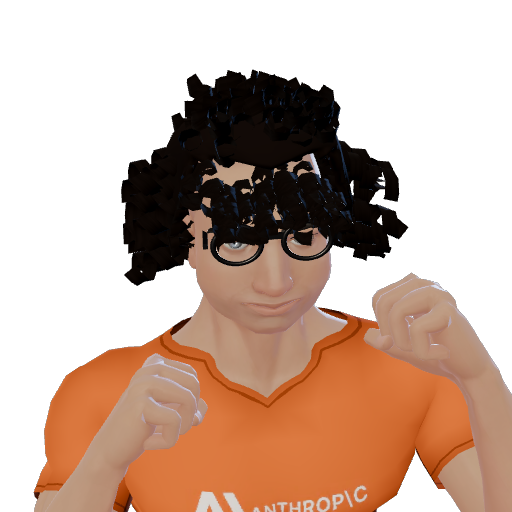
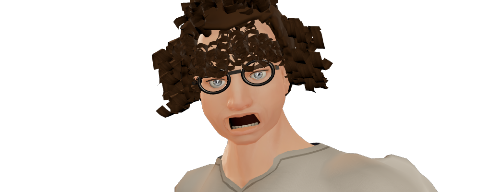
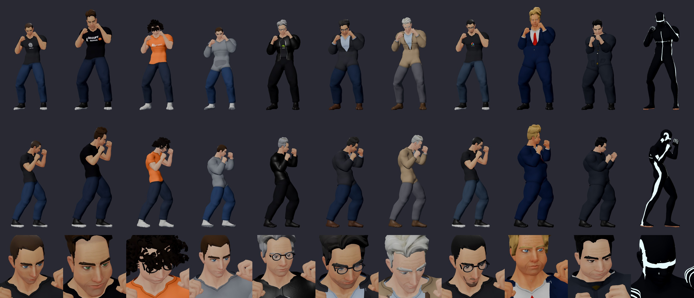

# Character Review: Dario Amoday (Likeness Pass)

## 1. Overview & Status

- **Character Name**: Dario Amoday
- **ID**: `dario`
- **Archetype**: Counter
- **Base Kit**: Lian (`data/kits/lian.tres`)
- **Voice**: Kenji (`voice_fallback = &"kenji"`)
- **Review Status**: **Awaiting owner review**

---

## 2. Visual Pass

### Face & Hair

- Age 43 with a soft oval academic jaw (`jaw = 0.98`), rounded chin (`chin_round = 0.006`)
  and a touch more cheek fullness (`fullness = 0.003`).
- Broader, thoughtful nose (`nose_width = 1.04`, `nose_bridge = 0.002`), calm dark-brown
  eyes (`eye_open = 0.0004`) and slightly fuller lips (`lips = 0.002`).
- Resting expression is earnest and mildly concerned: `brow_up = 0.45`,
  `brow_down = 0.15`, `smile = 0.14`; brows scaled `Vector3(1.02, 0.90, 1.0)`.
- Voluminous prominent curly mop (`Hair_CurlyMop`) in near-black brown
  `Color(0.12, 0.09, 0.08)`, with multi-octave helical curl harmonics, scaled
  `Vector3(1.08, 1.10, 1.08)`. Mirror palette is warm brown `Color(0.28, 0.20, 0.14)`.
- Accessories: signature thick black acetate glasses (`accessories = [&"thick_glasses"]`).

### Build & Posture

- Measured scholar build at `model_scale = 0.99`: torso `0.92–0.96`, arms `0.88–0.90`,
  legs `0.92` on the base skeleton.
- Calm upright posture (`spine_01/02 = 1°`, `neck_01 = 2°`, `Head = -2°`), built for the
  counter-hit read rather than a brawler's forward lean.
- Intro animation `fight/intro_wing_chun`, matching the Refusal Stance game plan.

### Outfit

- Terracotta/orange Anthropic tee `Color(0.82, 0.33, 0.14)` with ivory print
  (`assets/characters/prints/T_dario_tee.png`): the `A\` mark beside the `ANTHROP\C` wordmark.
- Dark indigo jeans `Color(0.14, 0.16, 0.22)`.
- Off-white canvas sneakers `Color(0.86, 0.86, 0.82)` with dark trim.
- Mirror palette: cream tee `Color(0.90, 0.88, 0.82)`, black jeans `Color(0.10, 0.10, 0.12)`,
  dark shoes `Color(0.12, 0.12, 0.12)`.

### Alternate Palette

---

## 3. Rendered Assets

| Asset | Path | Format |
|---|---|---|
| Portrait | `assets/ui/portraits/dario.png` | RGBA PNG, 512×512 |
| Super cut-in | `assets/ui/cutins/dario.png` | RGBA PNG, 1024×400 |
| Alt super cut-in | `assets/ui/cutins/dario_alt.png` | RGBA PNG, 1024×400 |
| Full roster sheet | `docs/screenshots/roster.jpg` | RGB JPEG (Dario is third on the left) |
| Aged skin | `assets/characters/aged/T_dario_skin.png` | RGBA PNG, 2048×2048 |
| Character resource | `data/characters/dario.tres` | Godot `CharacterData` |
| Baked outfit | `assets/characters/outfits/dario_outfit.res` | 5-surface `ArrayMesh` |
| Baked body | `assets/characters/outfits/dario_body.res` | Sculpted `ArrayMesh` |

---

## 4. Moveset & Voice Lines

- **Signature moves**:
  - `still_water` → **Refusal Stance**
  - `inch_palm` → **Interpretability Palm**
  - `willow_step` → **Responsible Scaling Step**
  - `chain_punch` → **Red-Team Chain**
  - `double_palm` → **Double-Check Palm**
  - `thousand_hands` / `thousand_finish` → **Constitutional Shield** (super)
- **Training trials**: Red-Team Chain, Double-Check Palm, Low Palm, Palm to the Wall,
  Constitutional Shield.
- **Stats**: 980 health, 1.7 back-walk, 6.2 dash, 0.95 weight, 115 throw damage,
  speed rating 0.6.
- **Intros**:
  - *"I'd estimate a ten to twenty-five percent chance this goes badly. For you."*
  - *"Let's do this carefully."*
  - *"I wrote a fifteen-thousand-word essay on why I'll win."*
- **Wins**:
  - *"Machines of loving grace. And one loving uppercut."*
  - *"That was a responsible scaling of force."*
  - *"I'm sorry, I can't help you get up."*
- **Rival**:
  - ram: *"We left for a reason." / "Safety first. Then the knockout."*

---

## 5. Simulation Verification

- **Command**: `godot_console --headless --path . -s res://tests/sim_test.gd`
- **Result**: `0 failure(s)`, exit code `0`; the suite's "no script errors during the run"
  check passed. The only console noise is the headless dummy renderer's benign
  `material is null` teardown warnings.

---

## 6. Review Checklist

- [ ] Prominent curly hair mop and thick dark glasses give a distinct Dario silhouette.
- [ ] Face reads age 43 — young enough to be a peer, old enough to be the careful one.
- [ ] Terracotta Anthropic tee and jeans hold up next to Yann's blazer/jeans.
- [ ] Counter stance reads patient, not passive.
- [ ] Alt cream/black palette is clearly different in the mirror match.

**Approve as-is, or send notes and I will revise.**
