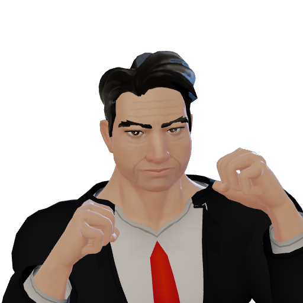
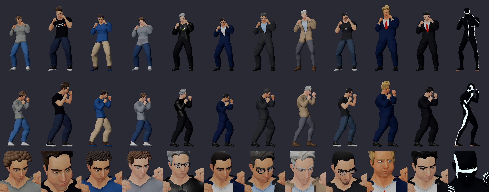

# Character Review: Xi Winping (Likeness Pass)

## 1. Overview & Status
- **Character Name**: Xi Winping
- **ID**: `xi`
- **Archetype**: Fortress (Heavy defensive anchor)
- **Base Kit**: Aelia (`data/kits/aelia.tres`)
- **Voice**: Brutus (`voice = &"brutus"`)
- **Review Status**: **Awaiting owner review** (per project workflow in `docs/HANDOFF.md`)

---

## 2. Visual Likeness Pass





### Detailed Likeness Specifications
- **Age Pass (Age 73)**: Configured at `age = 73` with procedural skin texturing generated via `tools/build_aged_skins.py` (`assets/characters/aged/T_xi_skin.png`). Adds natural mature forehead lines, brow furrows, subtle crow's feet, lower eyelid bags, nasolabial smile folds, marionette lines, and refined age spots appropriate for a 73-year-old statesman.
- **Hair & Styling**: Neatly groomed executive combed-back hair using `Hair_SimpleParted` mesh scaled with `hair_volume = [Vector3(1.04, 1.05, 1.04), Vector3(0, -0.002, -0.003)]`, tinted jet dyed black `Color(0.05, 0.05, 0.05)` with distinguished silver/grey alt `Color(0.28, 0.28, 0.30)`.
- **Facial Sculpting**: East Asian facial morphology parameterized via custom shape morphs in `tools/build_showdown_roster.gd`:
  - `eye_fold = 1.0` (pronounced epicanthic fold / monolid)
  - `eye_open = -0.0016`, `eye_tilt = 0.0008` (calm, focused, hooded eyes)
  - `nose_bridge = -0.004`, `nose_width = 1.12`, `nose_length = 0.002` (broad nasal base and characteristic bridge)
  - `fullness = 0.006`, `jaw = 1.04`, `face_length = 0.98` (broad, solid, dignified face outline)
  - `chin = -0.002`, `chin_round = 0.006`, `chin_forward = 0.001` (smooth, rounded jaw angle)
  - `jowls = 0.004`, `double_chin = 0.004` (mature statesman jawline)
  - `mouth_width = 0.98`, `lips = 0.001`, `brow = -0.002`
  - `face_rest = {smile = 0.22, squint = 0.15}` (stoic, polite resting demeanor)
  - Brows: `Vector3(1.02, 0.90, 1.0)`, Eyes: `DarkBrown`
- **Imposing Stance & Proportions**:
  - `scale = 1.02` (tall, formidable presence)
  - Broad, solid torso: `shape = {spine_01 = [Vector3(1.22, 1, 1.25), Vector3(0, 0, 0.02)], spine_02 = Vector3(1.15, 1, 1.18), spine_03 = Vector3(1.10, 1, 1.12), pelvis = Vector3(1.10, 1, 1.12), neck_01 = Vector3(1.16, 1, 1.16), Head = Vector3(1.06, 1.02, 1.04), upperarm = Vector3(1.06, 1, 1.06), lowerarm = Vector3(1.04, 1, 1.04), thigh = Vector3(1.06, 1, 1.06), calf = Vector3(1.04, 1, 1.04)}`.
  - Dignified, upright posture: `posture = {spine_02 = Vector3(-1, 0, 0), spine_03 = Vector3(-2, 0, 0), neck_01 = Vector3(1, 0, 0), Head = Vector3(-1, 0, 0)}`.
- **Wardrobe**: Tailored two-button dark suit with Chinese red tie (`_suit_spec` in `tools/build_outfits.gd`):
  - Suit: Dark charcoal/black fabric (`Color(0.08, 0.08, 0.09)`) with crisp white shirt (`white_shirt`).
  - Tie: Vibrant Chinese red tie (`Color(0.75, 0.08, 0.08)`).
  - Shoes: Polished black leather dress shoes (`Color(0.05, 0.05, 0.05)`).
  - Alt Suit: Diplomatic navy suit (`Color(0.14, 0.16, 0.22)`) with imperial gold tie (`Color(0.85, 0.68, 0.12)`).

---

## 3. Rendered Visual Assets & Artifact References

| Asset Description | File Path | Format & Resolution |
|-------------------|-----------|---------------------|
| **Full Roster Model Sheet** | `docs/screenshots/roster.jpg` | RGB8 JPEG, full 12-fighter lineup |
| **Character Portrait** | `assets/ui/portraits/xi.png` | RGBA PNG, 512x512 transparent |
| **Super Cut-In (Default)** | `assets/ui/cutins/xi.png` | RGBA PNG, 1024x400 transparent |
| **Super Cut-In (Alt)** | `assets/ui/cutins/xi_alt.png` | RGBA PNG, 1024x400 transparent |
| **Aged Skin Texture** | `assets/characters/aged/T_xi_skin.png` | RGBA PNG, 2048x2048 (VRAM ctex) |
| **Character Resource** | `data/characters/xi.tres` | Godot CharacterData Resource |
| **Baked Outfit Mesh** | `assets/characters/outfits/xi_outfit.res` | 5-surface ArrayMesh |
| **Baked Body Mesh** | `assets/characters/outfits/xi_body.res` | Sculpted base body ArrayMesh |

---

## 4. Moveset & Voice Lines

- **Signature Moves**:
  - `shield_rush` -> **Belt and Road Rush**
  - `rising_gauntlet` -> **Five-Year Plan**
  - `hammerfall` -> **Social Credit Hammer**
  - `gauntlet_drive` -> **State Media Drive**
  - `spur_rake` -> **Censor Sweep**
  - `emerald_oath` -> **Great Firewall**
  - `oath_finish` -> **Great Firewall** (Super Move)
- **Voice Lines & Intros**:
  - Intros:
    - *"This fight has been approved in advance."*
    - *"Search results for your victory: none found."*
    - *"Harmony will be restored."*
  - Wins:
    - *"This match did not happen."*
    - *"Your defeat is trending. Officially."*
    - *"Stability maintained."*
  - Rivalries:
    - Donald Tarrif: *"Your tariffs do not frighten me." / "Trade war: concluded."*

---

## 5. Simulation Verification

- **Command**:
  ```powershell
  godot --headless --path . -s res://tests/sim_test.gd
  ```
- **Execution Results**:
  - **All tests passed**: `0 failure(s)`
  - Exit code: `0`
  - Zero GDScript runtime errors
  - Complete game integrity verified across CPU-vs-CPU matches, move execution, hitboxes, and deterministic rollback state.
